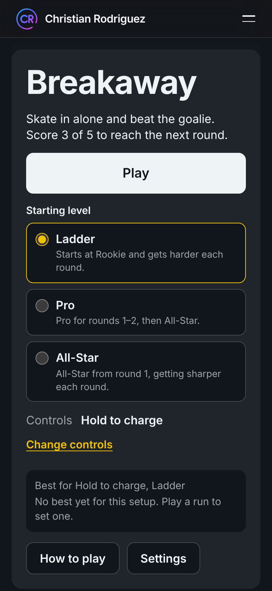
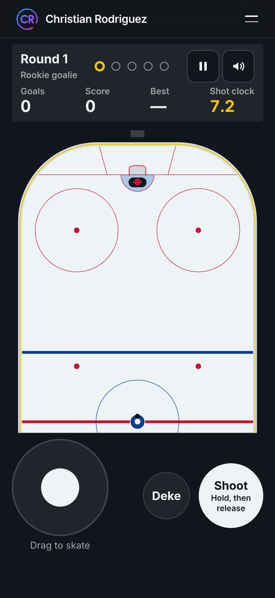
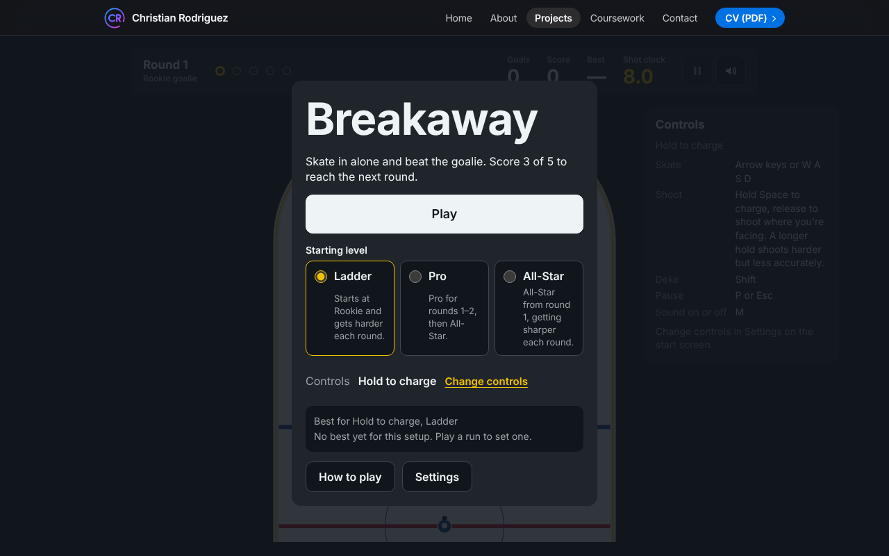
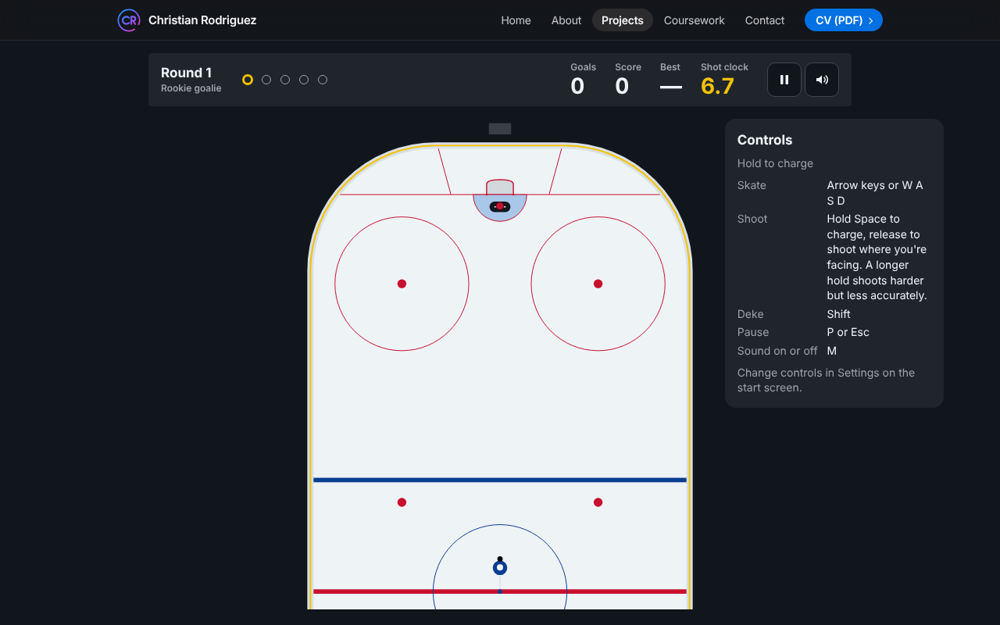

# Breakaway

Breakaway is a top-down hockey shootout against an AI goalie. I skate in from center ice, deke, shoot, and try to score. Each round is 5 attempts and I need 3 goals to reach the next round, against a goalie that gets sharper. I built it in plain JavaScript modules and Canvas 2D for my portfolio site, and it plays in the browser with no install.

**[Play Breakaway](https://christianrodriguez46.github.io/Projects/Breakaway/)**

| Start screen (phone) | Playing (phone) |
|---|---|
|  |  |

| Start screen (laptop) | Playing (laptop) |
|---|---|
|  |  |

## How to play

I pick one of three control schemes in Settings. The default is Hold to charge.

| Action | Hold to charge | Aim with mouse | One button |
|---|---|---|---|
| Skate | Arrows or WASD | Arrows or WASD | Arrows or WASD |
| Shoot | Hold Space, release to shoot where I'm facing. Longer is faster but less accurate | Click to shoot toward the pointer | Tap Space |
| Deke | Shift | Shift or right mouse button | none |
| Touch | Drag the stick, hold and release Shoot, tap Deke | Drag the stick, tap the rink to shoot, tap Deke | Drag the stick, tap Shoot |

P or Escape pauses. M turns sound on or off. I have 8 seconds per attempt. A goal is 100 points, and 50 more if the goalie bit on a deke first. Aim with mouse needs a mouse or a touch screen.

## How I built it

I used plain JavaScript ES modules and the Canvas 2D API. There are no runtime dependencies and no build step, so the game is published the same way as the rest of my site: commit and push to GitHub Pages. Node is only used for tests and development tools.

The code is split in two. `src/core/` holds every rule (physics, collisions, goalie AI, scoring, round rules, saved-data checks) as plain functions with no browser code, and random numbers come in as a seeded function. `src/browser/` is a thin shell that runs a fixed-step loop (120 steps a second inside `requestAnimationFrame`), reads input, draws the canvas, plays synthesized sound, saves settings and announces results to screen readers. That split lets me test the rules in Node with the same seed every time, and a `?seed=` URL parameter does the same thing in the browser.

More detail:

- [Decisions](docs/decisions.md): the stack, the loop, the core and shell split, and the units, with the options I weighed.
- [Physics](docs/physics.md): skater, puck, rink and swept collisions.
- [Goalie AI](docs/goalie-ai.md): the goalie's modes and the difficulty tier table.
- [Rules and scoring](docs/rules-and-scoring.md): rounds, outcomes, scoring, saved data and privacy.
- [Browser layer](docs/browser.md): loop, renderer, input, touch, audio, storage, UI and accessibility.
- [Learning notes](docs/learning/game-loop-notes.md), [physics notes](docs/learning/physics-notes.md), [goalie AI notes](docs/learning/goalie-ai-notes.md) and [exercises](docs/learning/exercises.md).
- [Changelog](CHANGELOG.md) and [iteration log](ITERATION_LOG.md).

## Run it locally

I use WSL2 Ubuntu. The game needs a web server because browsers won't load ES modules from `file://`.

```bash
mkdir -p ~/REPO && cd ~/REPO
git clone https://github.com/ChristianRodriguez46/ChristianRodriguez46.github.io.git
cd ChristianRodriguez46.github.io
python3 -m http.server 4101
```

Then I open http://localhost:4101/Projects/Breakaway/ in my browser. I serve the repository root, not the game folder, so the shared site styles load. [SETUP.md](SETUP.md) has the full setup.

## Run the tests

```bash
cd Projects/Breakaway
npm install     # once
npm test
```

## Project layout

```
Projects/Breakaway/
  index.html        the game page
  style.css         the game's styles
  about.html        the About page on my site
  src/core/         pure rules: physics, goalie, scoring, settings, constants
  src/browser/      loop, renderer, input, touch, audio, storage, UI
  tests/            unit, integration, stats and site checks
  docs/             decisions, feature docs, learning notes, screenshots
  SETUP.md  CHANGELOG.md  ITERATION_LOG.md
```

## Privacy

The game saves two `localStorage` keys, `breakaway.settings` and `breakaway.best_scores`, on the player's own device. Nothing is sent anywhere. The page has no analytics, no cookies and no requests to other sites. Settings has a button that clears both keys.

## License

My code is under the MIT license. See the repository's LICENSE file.
